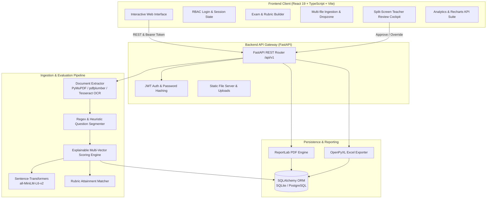

# 🎓 GradeAI — Intelligent Automated Exam Evaluation & Review System

<div align="center">


[](https://fastapi.tiangolo.com/)
[](https://www.python.org/)
[](https://react.dev/)
[](https://www.typescriptlang.org/)
[](https://vitejs.dev/)
[](https://tailwindcss.com/)
[](https://pytorch.org/)
[](https://huggingface.co/sentence-transformers/all-MiniLM-L6-v2)
[](LICENSE)
[](https://github.com/vijju9019/GradeAI/pulls)

**Production-grade, Explainable AI-driven Examination Evaluation Platform featuring Hybrid Multi-Factor NLP Scoring, Intelligent OCR Extraction, Automated Question Segmentation, and a Human-in-the-Loop Teacher Review Cockpit.**

[Key Features](#-key-features) • [Architecture](#-system-architecture) • [AI Scoring Engine](#-explainable-ai-scoring-engine) • [Quick Start](#-quick-start-guide) • [API Documentation](#-api-documentation) • [Testing](#-testing--quality-assurance)

</div>

---

## 📌 Executive Overview

Traditional academic evaluation faces three fundamental bottlenecks:
1. **Grader Fatigue & Latency:** Grading hundreds of descriptive answer sheets takes weeks, delaying student feedback loops.
2. **Subjectivity & Inconsistency:** Inter-rater variability leads to differing scores for identical student competencies.
3. **The Black-Box Dilemma:** Generic LLMs frequently hallucinate scores without verifiable rubric compliance, failing institutional audits.

**GradeAI** bridges the gap between state-of-the-art NLP automation and institutional trust. Rather than relying on opaque end-to-end black-box generation, GradeAI implements a **transparent, multi-vector scoring pipeline**:

$$\text{Final Mark} = f\Big(\text{Keywords}, \ \text{TF-IDF Cosine Similarity}, \ \text{Dense Semantic Embeddings}, \ \text{Rubric Criteria Attainment}\Big)$$

Every mark is accompanied by **matched/missing keywords**, **verifiable evidence quotes**, **rubric criterion breakdowns**, and a **confidence score** (High, Medium, Low). Teachers maintain full sovereignty through a **split-screen review cockpit** with one-click approval or granular mark overrides.

---

## 🌟 Key Features

### 🔍 1. Hybrid Multi-Signal NLP Evaluation Engine
- **Dense Semantic Understanding:** Encodes student and reference answers using Hugging Face's `sentence-transformers/all-MiniLM-L6-v2` dense vectors.
- **Lexical Precision (TF-IDF & Cosine Similarity):** Captures terminology accuracy, sentence structure, and phrase fidelity.
- **Essential Keyword & Concept Extraction:** Checks mandatory technical terms, core domain concepts, and synonym variations.
- **Rubric Criterion Matching:** Evaluates individual sub-questions and marking rubrics step-by-step.
- **Length & Conciseness Normalization:** Prevents artificial inflation from superficial length while protecting concise, accurate answers.

### 🧠 2. Transparent Explainable AI (XAI) & Confidence Gauges
- **Granular Confidence Rating:** Automatically flags evaluations as `High`, `Medium`, or `Low` based on agreement between lexical and semantic signals.
- **Explainability Evidence:** Highlights exact sentence fragments from the student's submission justifying marks.
- **Uncertainty Diagnostics:** Pinpoints why a grade might require manual attention (e.g., high divergence between lexical vs. semantic meaning, brevity on essay prompts).

### 👨‍🏫 3. Human-in-the-Loop Teacher Review Cockpit
- **Split-Screen Grading Interface:** Side-by-side view comparing original student submission text against model answers and rubric criteria.
- **Interactive Mark Overrides:** Teachers can adjust scores per rubric criterion or question with mandatory change reasoning.
- **Batch Workflows:** Batch-approve high-confidence AI grades with a single click, saving up to 80% of evaluation time.
- **Auditing & Status Tracking:** Track submission states across `Uploaded` ➔ `Extracted` ➔ `Evaluated` ➔ `In Review` ➔ `Approved` ➔ `Finalized`.

### 📄 4. Multimodal Document Ingestion & OCR
- **Universal Formats:** Supports PDF, DOCX, TXT, scanned images (`PNG`, `JPEG`, `TIFF`).
- **OCR Engine:** Embedded OCR powered by `pytesseract` and `pdfplumber` with automated image binarization and thresholding for handwritten/scanned scripts.
- **Heuristic Question Segmentation:** Detects question identifiers (e.g., `Q1:`, `Question 2`, `1(a)`) to segment composite answer sheets into individual questions automatically.

### 📊 5. Comprehensive Analytics & Export Engine
- **Institutional PDF Grade Sheets:** High-resolution printable PDF scorecards generated dynamically with ReportLab.
- **Excel Gradebooks:** Formatted `.xlsx` exports via OpenPyXL with score statistics, question-level marks, and pass/fail indicators.
- **Visual Analytics:** Interactive Recharts dashboard visualizing grade distributions, question difficulty indices, and rubric mastery percentages.

---

## 🏗️ System Architecture



---

## 🧮 Explainable AI Scoring Engine

The scoring engine evaluates each answer across four distinct orthogonal vectors:

| Scoring Factor | Mathematical Basis | Weight | Role in Assessment |
| :--- | :--- | :---: | :--- |
| **Keyword Coverage ($S_k$)** | $S_k = \frac{\|K_{\text{matched}}\|}{\|K_{\text{required}}\|}$ | **20%** | Guarantees presence of foundational domain terminology. |
| **Lexical Similarity ($S_c$)** | $\text{Cosine}(v_{\text{student}}, v_{\text{model}})_{\text{TF-IDF}}$ | **25%** | Evaluates exact phrasing and grammatical structure. |
| **Semantic Similarity ($S_s$)** | $\frac{e_{\text{student}} \cdot e_{\text{model}}}{\|e_{\text{student}}\| \|e_{\text{model}}\|}$ | **35%** | Evaluates conceptual correctness, even with paraphrased vocabulary. |
| **Rubric Compliance ($S_r$)** | $\frac{1}{M}\sum_{i=1}^{n} \text{marks}_i \cdot \mathbb{I}(\text{criterion}_i)$ | **20%** | Verifies granular criteria fulfillment (step-by-step logic, definitions). |

### Composite Mark Calculation:
$$\text{Composite Ratio} = w_k S_k + w_c S_c + w_s S_s + w_r S_r$$

$$\text{Suggested Marks} = \text{Round}\Big(\min(M_{\text{max}}, \max(0, \text{Composite Ratio} \times M_{\text{max}})), \ 2\Big)$$

### Automated Confidence & Uncertainty Triggers:
A submission is categorized into confidence tiers based on signal agreement:
- **High Confidence ($\ge 85\%$):** Lexical and semantic scores are closely aligned ($\Delta < 0.20$), required keywords are present, and length constraints are met.
- **Medium Confidence ($70\% - 84\%$):** Slight divergence between vocabulary choice and semantic embedding.
- **Low Confidence ($< 70\%$ / Divergent):** Significant contradiction between lexical presence and conceptual depth, or missing critical terminology. Flagged automatically for human review.

---

## 💻 Tech Stack

| Domain | Technologies |
| :--- | :--- |
| **Backend Framework** | **FastAPI**, **Uvicorn**, **Pydantic v2**, **Python 3.10+** |
| **Database & ORM** | **SQLAlchemy 2.0**, SQLite (dev) / PostgreSQL (prod ready) |
| **Machine Learning / NLP** | **Sentence-Transformers** (`all-MiniLM-L6-v2`), **PyTorch**, **scikit-learn** |
| **Document Processing & OCR** | **PyMuPDF (fitz)**, **pdfplumber**, **PyPDF**, **pytesseract**, **Pillow** |
| **Report Generation** | **ReportLab** (Vector PDFs), **OpenPyXL** (Spreadsheets) |
| **Frontend Framework** | **React 19**, **TypeScript**, **Vite** |
| **Styling & Icons** | **Tailwind CSS v4**, **Lucide React** |
| **Data Visualization** | **Recharts** (Distribution Curves, Bar/Line charts, Donut KPIs) |
| **Routing & Forms** | **React Router DOM v7**, **React Hook Form**, **Zod** |
| **Testing** | **Pytest**, **HTTPX**, **Oxlint** |

---

## 🚀 Quick Start Guide

### Prerequisites
- **Python**: `3.10` or higher
- **Node.js**: `18.x` or higher (`npm` or `pnpm`)
- **Tesseract OCR** (Optional, required only for scanned image OCR):
  - *Ubuntu/Debian:* `sudo apt install tesseract-ocr`
  - *macOS:* `brew install tesseract`
  - *Windows:* Download installer from [UB-Mannheim](https://github.com/UB-Mannheim/tesseract/wiki) and add to PATH.

---

### 1. Clone the Repository
```bash
git clone https://github.com/vijju9019/GradeAI.git
cd GradeAI
```

### 2. Backend Setup
```bash
# Navigate to backend directory
cd backend

# Create virtual environment
python -m venv venv

# Activate virtual environment
# Windows (PowerShell):
.\venv\Scripts\Activate.ps1
# Linux / macOS:
source venv/bin/activate

# Install dependencies
pip install -r requirements.txt

# Configure environment variables
cp ../.env.example .env
```

### 3. Frontend Setup
```bash
# In a new terminal window, navigate to frontend
cd frontend

# Install npm packages
npm install
```

### 4. Seed Demo Data & Start Applications
GradeAI comes equipped with a comprehensive demo data seeder including realistic courses (*CS301: Data Structures & Operating Systems*), multi-part rubrics, student submissions, and evaluations.

```bash
# From repository root (with backend venv active):
python scripts/seed_demo_data.py
```

Now launch both servers:

**Start Backend (FastAPI):**
```bash
cd backend
uvicorn app.main:app --reload --host 127.0.0.1 --port 8000
```
*API will be running at [http://127.0.0.1:8000](http://127.0.0.1:8000)*  
*Swagger Documentation: [http://127.0.0.1:8000/docs](http://127.0.0.1:8000/docs)*

**Start Frontend (Vite):**
```bash
cd frontend
npm run dev
```
*Web application will be running at [http://localhost:5173](http://localhost:5173)*

---

## 🔑 Pre-Seeded Demo Credentials

| Role | Email Address | Password | Permissions |
| :--- | :--- | :--- | :--- |
| 👨‍🏫 **Teacher / Evaluator** | `teacher@gradeai.edu` | `password123` | Create exams, define rubrics, upload answer sheets, review & override grades |
| 🛠️ **Administrator** | `admin@gradeai.edu` | `admin123` | System diagnostics, ML model status, user management, audit logs |

---

## 🧪 Testing & Quality Assurance

GradeAI maintains comprehensive test suites for both unit evaluation and end-to-end integration workflows.

### Run Backend Unit & Integration Tests:
```bash
cd backend
pytest tests/ -v
```

### Run Automated End-to-End Workflow Verification:
GradeAI includes an automated headless verification script that executes the complete operational pipeline:
- Logs in as teacher
- Verifies system health & ML model readiness
- Creates a new examination with multi-part rubrics
- Ingests student answer sheets
- Executes question segmentation & NLP evaluation
- Overrides a rubric score with feedback
- Generates official PDF and Excel grade reports

```bash
# Run against running backend server:
python scripts/verify_e2e_workflow.py
```

### Run Frontend Linter & Build Check:
```bash
cd frontend
npm run lint
npm run build
```

---

## 📡 API Documentation

GradeAI provides a fully documented RESTful API conforming to OpenAPI 3.1 standards. When the server is active, explore the interactive Swagger documentation at `http://127.0.0.1:8000/docs`.

### Key Endpoint Groups:

| Module | Route Prefix | Primary Operations |
| :--- | :--- | :--- |
| **Authentication** | `/api/v1/auth` | `/login`, `/register`, `/me` |
| **Examinations** | `/api/v1/examinations` | CRUD operations on exams, metadata, and status lifecycle |
| **Questions & Rubrics** | `/api/v1/examinations/{id}/questions` | Question creation, model answers, keywords, rubric criteria |
| **Submissions** | `/api/v1/examinations/{id}/submissions` | Register student submissions, track evaluation lifecycle |
| **Documents & OCR** | `/api/v1/documents` | Upload PDF/images, extract text, trigger segmentation |
| **Evaluation Engine** | `/api/v1/evaluations` | Execute AI grading, compute semantic & lexical similarity |
| **Teacher Reviews** | `/api/v1/reviews` | Override marks, add feedback, batch-approve submissions |
| **Reports & Export** | `/api/v1/reports` | Download PDF scorecards (`/pdf`) and Excel sheets (`/excel`) |
| **Analytics** | `/api/v1/analytics` | Exam-wide grade distributions, question difficulty stats |
| **Admin & Health** | `/api/v1/admin` | `/health`, system diagnostics, model readiness status |

---

## 📁 Repository Directory Structure

```plaintext
GradeAI/
├── .env.example                  # Environment configuration template
├── README.md                     # Comprehensive project documentation
├── backend/                      # FastAPI Python Application
│   ├── app/
│   │   ├── api/v1/               # Modular REST API endpoints
│   │   │   ├── auth.py           # Authentication & token generation
│   │   │   ├── examinations.py   # Exam lifecycle management
│   │   │   ├── questions.py      # Questions & marking rubrics
│   │   │   ├── submissions.py    # Student answer sheet ingestion
│   │   │   ├── documents.py      # File upload & OCR handling
│   │   │   ├── evaluation.py     # AI evaluation endpoints
│   │   │   ├── reviews.py        # Teacher review & override workflow
│   │   │   ├── reports.py        # PDF & Excel export handlers
│   │   │   ├── analytics.py      # Performance KPIs & metrics
│   │   │   └── admin.py          # System diagnostics & health check
│   │   ├── core/                 # App configuration, security, DB engine
│   │   ├── ml/                   # Model loader & embedding services
│   │   ├── models/               # SQLAlchemy ORM data models
│   │   ├── schemas/              # Pydantic validation schemas
│   │   ├── services/             # Core business logic
│   │   │   ├── nlp_evaluator.py  # Multi-factor explainable scoring engine
│   │   │   ├── document_extractor.py # PyMuPDF & Tesseract OCR pipeline
│   │   │   ├── segmenter.py      # Question splitting heuristics
│   │   │   ├── teacher_review.py # Review cockpit & mark approval logic
│   │   │   ├── report_generator.py # ReportLab PDF & OpenPyXL Excel builders
│   │   │   └── analytics_service.py # Grade distribution & KPI calculations
│   │   └── main.py               # Application entrypoint & CORS middleware
│   ├── requirements.txt          # Python dependencies
│   └── tests/                    # Pytest test suites
├── frontend/                     # React 19 + TypeScript + Vite Application
│   ├── src/
│   │   ├── api/                  # Axios/Fetch API client bindings
│   │   ├── components/           # Reusable UI widgets & status badges
│   │   ├── context/              # Authentication & user state context
│   │   ├── pages/                # Application views
│   │   │   ├── DashboardPage.tsx     # Overview metrics & quick actions
│   │   │   ├── ExamsPage.tsx         # Exam repository & status filters
│   │   │   ├── ExamBuilderPage.tsx   # Rubric & question editor
│   │   │   ├── UploadCenterPage.tsx  # Document upload & OCR trigger
│   │   │   ├── TeacherReviewPage.tsx # Split-screen grading cockpit
│   │   │   ├── AnalyticsPage.tsx     # Recharts performance charts
│   │   │   ├── ReportsPage.tsx       # Export center (PDF / Excel)
│   │   │   ├── SettingsPage.tsx      # Scoring weights & OCR settings
│   │   │   └── LoginPage.tsx         # Role-based access control login
│   │   ├── App.tsx               # Route definitions & protected routes
│   │   └── main.tsx              # React mounting root
│   ├── package.json              # Frontend npm dependencies
│   └── vite.config.ts            # Vite configuration
└── scripts/                      # Utility & automation scripts
    ├── seed_demo_data.py         # Populates DB with rich demo exam dataset
    └── verify_e2e_workflow.py    # Automated end-to-end integration test
```

---

## 🗺️ Roadmap & Future Enhancements

- [ ] **Handwriting Recognition Specialization:** Fine-tuning Vision-Language Models (TrOCR / Donut) for handwritten mathematical formulas and diagrams.
- [ ] **LMS Integration (LTI 1.3):** Direct sync with Canvas, Moodle, Blackboard, and Google Classroom gradebooks.
- [ ] **Multi-Lingual Evaluation:** Support for non-English descriptive answers using multilingual sentence transformers (`paraphrase-multilingual-mpnet-base-v2`).
- [ ] **Syntactic Plagiarism & AI-Attribution Signals:** Detection of cross-student submission copying and synthetic LLM generation markers.

---

## 📄 License

This project is open-source software licensed under the **[MIT License](LICENSE)**.

---

<div align="center">

**Built with ❤️ for Educators, Institutions, and Learners.**

*Empowering teachers with trustworthy, transparent, and explainable AI assessment.*

[Report a Bug](https://github.com/vijju9019/GradeAI/issues) • [Request a Feature](https://github.com/vijju9019/GradeAI/issues) • [Submit a Pull Request](https://github.com/vijju9019/GradeAI/pulls)

</div>